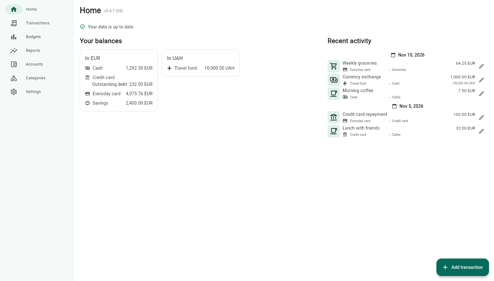
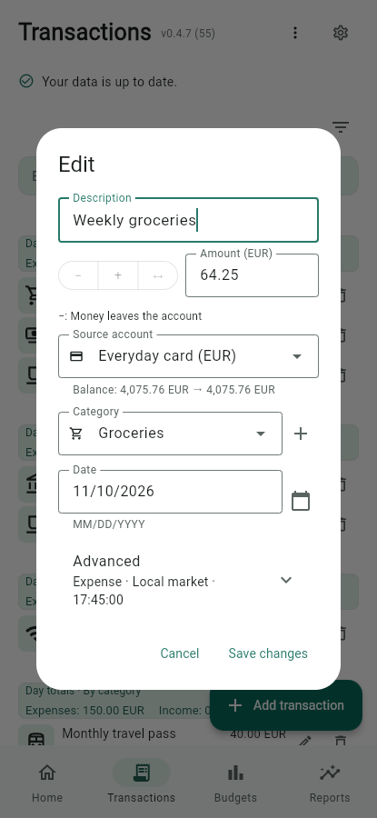
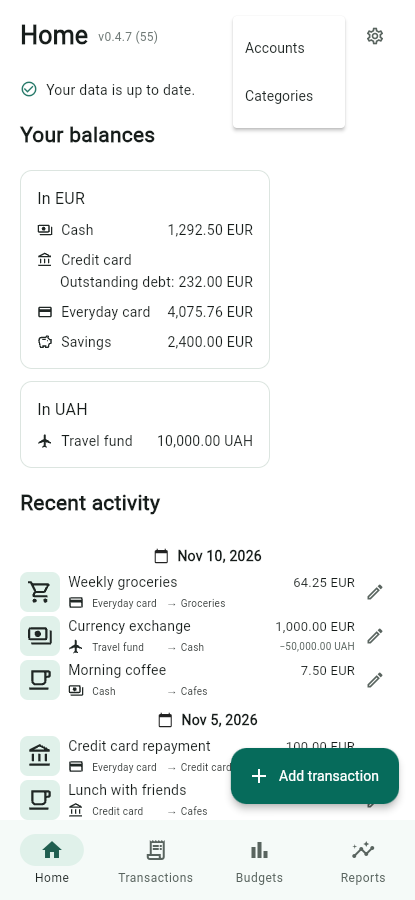

  

<h1 align="center">TextMoney</h1>

Track everyday spending, see what’s left in your accounts, and set monthly
budgets for things like groceries and eating out.

<strong>Android · Windows · Linux</strong>

Works offline with no sign-up. Your records are stored in a plain-text
[Beancount](https://beancount.github.io/) file in a folder you choose.
You can [sync the whole folder between Android, Windows and Linux](docs/synchronization.md)
using an external synchronization tool. TextMoney has no built-in sync;
each device needs a fully accessible local copy, and sync must finish before
editing on another device.

  <a href="https://github.com/pioneer/textmoney/releases/latest"><strong>Download TextMoney</strong></a> ·
  <a href="docs/user-guide.md">User guide</a> ·
  <a href="docs/synchronization.md">Sync between devices</a> ·
  <a href="docs/platform-notes.md">Platform notes</a>

  
   
  <em>Desktop layout</em>

  
  
   
  <em>Mobile layout</em>

## What you can do

- **See where your money goes.** Record expenses and income, organise spending
  by category, and see how much you spent this month or over a period you choose.
- **Keep track of your accounts.** See how much you have in cash and bank
  accounts, and how much you still owe on credit cards and loans. Record
  transfers between accounts, including exchanges between currencies.
- **Stay within your budget.** Set spending limits by category and see how much
  of each monthly budget you’ve used, right from the home screen.

Available in English, Ukrainian, and Russian.
Developers are welcome to submit a pull request with translation corrections
or a new language; see the [translation guide](docs/localization.md).
Weblate integration may be added in the future; it is not configured yet.

## Get started

1. Open TextMoney and choose a folder for your records.
2. Add an account, such as Cash or your bank account.
3. Record your first expense and choose or create a category for it.

*TextMoney is in beta. Keep a separate backup of your financial records.*

## Guides and technical details

Already using Beancount? Check the [supported journal format](docs/journal-format.md)
before opening an existing file. TextMoney supports a subset of Beancount
in a single journal file. TextMoney preserves unrelated journal content.
Unsupported accounting semantics prevent loading or saving without modifying
the file; some supported transactions are view-only.

| You want to… | Read |
| --- | --- |
| Get an overview of current features and limits | [Feature overview](docs/features.md) |
| Record expenses, income, refunds, transfers or debt repayments | [User guide](docs/user-guide.md) |
| Set spending limits and review monthly budgets | [Budgeting](docs/budgets.md) |
| Understand spending reports and currency-separated totals | [Reporting](docs/reporting.md) |
| Use the same records on several devices | [Synchronization](docs/synchronization.md) |
| Keep backups or recover from an interrupted save | [Backups and recovery](docs/data-safety.md) |
| Choose a release file or troubleshoot platform requirements | [Platform notes](docs/platform-notes.md) |
| Run from source or build the app | [Development and builds](docs/development.md) |
| See what changed between releases | [Release notes](https://github.com/pioneer/textmoney/releases) |
