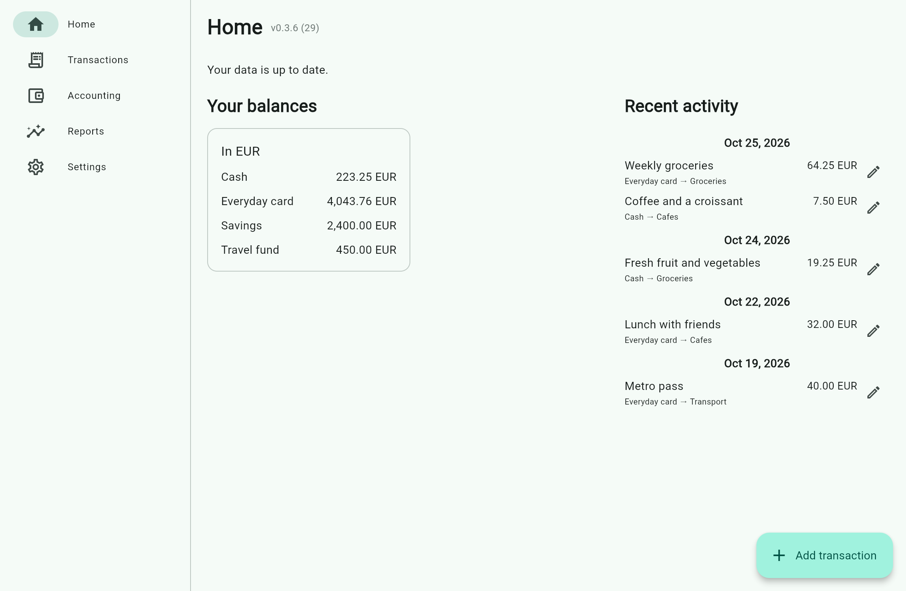
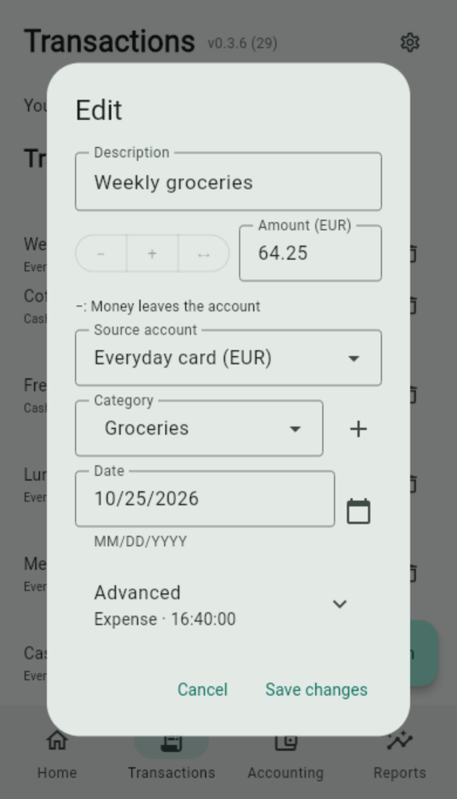
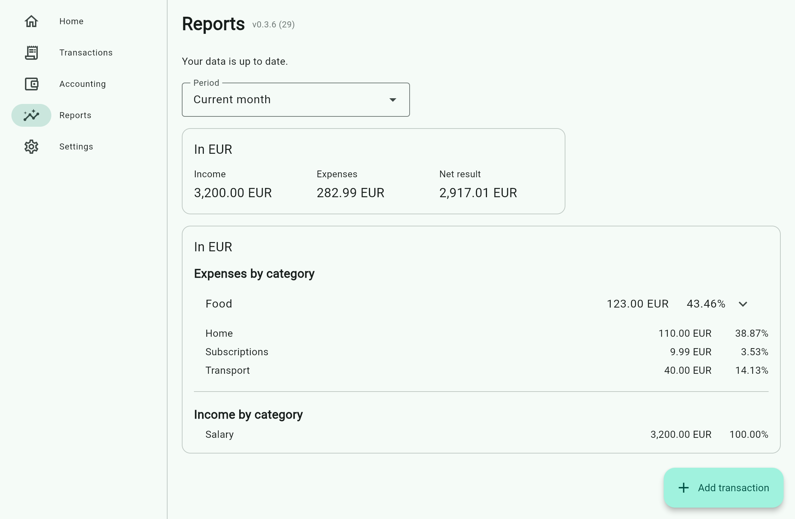

# TxnCount

An offline-first personal expense tracker that keeps your data in
plain-text [Beancount](https://beancount.github.io/) files in a folder you choose.
No sign-up, backend service, or app-managed cloud storage.

**Alpha software:** features and file support are still limited, and bugs are
possible. Keep independent backups of important financial data.

TxnCount is being developed with substantial AI assistance.



*Desktop Home. All screenshots use synthetic EUR data in the v0.3.6 web preview;
they are not personal financial data or Android device captures.*

## Implemented

- Record and edit expenses with an account, category, amount, date/time and
  description. Add an optional shop/recipient when needed.
- Record income, expense reimbursements and balance-only adjustments. Partial
  reimbursements can go to a different account; linking the original expense
  is optional. Reimbursements reduce net expenses rather than count as income.
- Manage single-currency accounts and opening balances.
- Transfer between own accounts, including cash, loan repayments and currency
  exchanges. Enter both actual amounts for exchanges; the rate is calculated
  excluding optional fees in either account's currency.
- Organize expenses with hierarchical categories.
- Review balances in the configured currency order and compact transaction rows
  grouped by date, with summaries above account movements.
- Use compact phone and desktop layouts, with Settings in a top-right gear on
  mobile and in the navigation rail on wider screens. Transactions, Reports,
  Accounting and wider-layout Settings reserve scrolling space below content
  for the floating Add button.
- View income, net expenses and net result in currency-specific period reports,
  with current/previous month, year-to-date or custom date ranges and category
  breakdowns.
- Delete editable transactions after confirmation; deactivate and reactivate
  accounts and categories with history rather than losing their records.
- Use system, light or dark appearance, and system or explicit timezones.
- Available translations: **English, Ukrainian and Russian**.
- Keep read-verified backups with automatic retention and a manual cleanup
  preview. Detect conflicting external changes before saving and review
  interrupted Android saves explicitly.
- Review external changes through read-only summaries and diffs, without merging
  or rewriting synchronization copies. Stale saves are rejected while unsaved
  input remains visible; reopen the edit against the current journal before
  submitting again.
- Use standard Beancount journal display currencies, account display names, local
  transaction times and reimbursement links, without converting or combining
  different currencies.
- See the app version and build number in every screen header and Settings.

## Future plans

Planned areas include budgets and split-expense editing. Priorities and scope
may change during alpha, with no release dates promised.

### Editing and synchronization

Use one writer at a time. Save and close the editing session, let
Dropbox/Dropsync (or your chosen tool) finish uploading, and wait for it to finish
downloading on the next device before editing there. TxnCount does not contact
cloud APIs, synchronize files, merge journals or resolve cloud conflicts.
A possible-conflict filename notice is advisory, not proof that synchronization
has completed or that every conflicting copy has been found.
Hash checks, verified backups and Android interrupted-save review protect local
saves, but cannot prevent every race with another writer or synchronization tool.
See [Your data and synchronization](#your-data-and-synchronization) for the
save guarantees and recovery limits.

Account/category labels use `name:` metadata. Transaction time uses local
`time: "HH:MM"` or `time: "HH:MM:SS"` metadata, without a timezone or stored
creation instant; timezone selection only affects the default clock, not saved transactions.
Reimbursements can share native Beancount links with expenses. New entries do
not write app-generated `id:` metadata. Fee-category defaults are local settings;
`txncount-active` remains the visibility/reactivation preference.
See the [file and synchronization contract](docs/synchronization.md).

## Get the app

Download the production-signed Android APK or Linux x86_64 AppImage from
**[GitHub Releases](https://github.com/pioneer/txncount/releases/latest)**.
Android 7.0 or newer is required. You can also track this repository with
[Obtainium](https://github.com/ImranR98/Obtainium) for updates.

Android and Linux x86_64 AppImage downloads are published. Windows support is
implemented but has not yet been validated; there is no Windows release download.
Android APKs use the maintained production signing certificate. Newer releases
can update an existing installation in place.

### Linux AppImage

Download `TxnCount-<version>-x86_64.AppImage` from
[GitHub Releases](https://github.com/pioneer/txncount/releases).
The AppImage is built on Ubuntu 24.04; use Ubuntu 24.04 or newer, or an up-to-date
x86_64 Arch Linux system with a compatible desktop environment. No `uv` or
separate Python installation is needed.

**Ubuntu 24.04 or newer:** if FUSE 2 compatibility is missing, install its library
alongside the system's existing FUSE packages:

```sh
sudo apt update
sudo apt install libfuse2t64
```

**Arch Linux:** if FUSE 2 compatibility is missing:

```sh
sudo pacman -Syu fuse2
```

Then, on either distribution, open a terminal in the download directory, replace
`<version>` below with the downloaded version, and run without installing:

```sh
APPIMAGE="./TxnCount-<version>-x86_64.AppImage"
chmod +x "$APPIMAGE"
"$APPIMAGE"
```

To update, download the newer AppImage and run it instead; remove the old file
when convenient. Your journal remains in the folder you selected, and Linux
preferences stay under `${XDG_CONFIG_HOME:-~/.config}/txncount`. If FUSE is
unavailable, use `APPIMAGE_EXTRACT_AND_RUN=1 "$APPIMAGE"` instead. See the
[AppImage FUSE guide](https://docs.appimage.org/user-guide/troubleshooting/fuse.html)
for distribution details. The AppImage does not include the host graphics driver,
display server, or glibc; these instructions are not certification of every
Ubuntu or Arch configuration.

## Getting started

1. Open TxnCount and choose a dedicated local data folder.
2. Create an account with its currency and, optionally, an opening balance.
3. Add expense categories under **Accounting → Categories**.
4. Use **Add transaction**, enter a description in the first
   field, then a positive amount, select the account and category, and save.
   The default **−** records spending; the hint below the amount explains the sign.

Switch to **+** for ordinary income; the numeric amount stays unchanged and
the category selector shows income categories. For special receipts, use
**Advanced → Money received**:
**Expense reimbursement** reduces an expense category, while
**Balance adjustment** records receipts that should affect neither
income nor current expenses (for example, recovery of a pre-tracking purchase).
Create income categories under **Accounting → Categories** by selecting the Income category type.
Reimbursements reduce expenses on the date received, which can produce negative
net expenses in that period. A linked expense is a reference, not a tracked debt.

Choose **↔** beside **− / +** to transfer money. Transfer mode shows required
**source** and **destination** accounts; minus and plus only show one account.
The hint explains debit, credit or transfer without calling any account "main".
The preview shows the transfer direction. For same-currency transfers,
enable a fee under Advanced and choose whether it is added on top or deducted
from the amount. Change its category for that transfer, or set the default
under Settings. The bank-fee category is created automatically on first use.
For loans, choose **Loan / credit** when creating the account and enter the
opening amount owed. Balances use standard Beancount signs: debt is negative;
a transfer into the loan account reduces it.

For accounts in different currencies, enter **Total debited** and
**Actually credited**. Neither amount is calculated or replaced.
If there is a fee, select its currency: a source-currency fee is included in the
debited total; a destination-currency fee has already been withheld from the
credited amount. The preview shows the exchanged principal and derived rate
excluding fees. For example, 105 USD debited with a 5 USD fee and 4200 UAH
credited means 100 USD exchanged at 42 UAH/USD.
Changing the selected mode never changes entered amounts. To reverse a transfer,
change its source/destination accounts and exchanged amounts explicitly.
Fee currency remains explicit under Advanced.

Negative cash/bank balances—including past overdrafts—show a warning but do not
prevent saving. Invalid amounts, account selections and accounting still block saving.

Use the pencil and trash icons to edit or delete transactions. The same form
opens for editing, with the operation type fixed to preserve its accounting
treatment; transfer direction can still be reversed. Advanced starts collapsed,
with a summary of saved fees, payee and time when editing. Date remains visible;
time and optional counterparty are under Advanced. Opening balances can
be edited from either the account or its opening transaction. Accounts and
categories with history can be deactivated and reactivated; their records remain.



*Editing an expense in the compact layout.*

Settings lets you choose appearance and timezone. **Advanced → Journal display
currencies** controls Home balance section order and how compatible applications
organize amounts. Account currencies not listed appear afterward alphabetically;
currencies without accounts do not create empty sections. Save the settings to
apply the order. This does not exchange currencies or combine balances.

The **Reports** section summarizes recognized income, net expenses and their
difference for the current month, previous month, year to date or a custom date
range. Category totals include reimbursements on their recorded dates, and
transfer fees remain expenses while transfer/loan principal and balance
adjustments are excluded. Amounts in different currencies are always shown
separately; reports do not infer exchange rates.



*A monthly report with separate income and expense category breakdowns.*

## Your data and synchronization

Your selected folder contains a single UTF-8 journal, `txncount.beancount`,
and a `backups/` directory. Android additionally keeps interrupted-save recovery
records. TxnCount accesses these files directly; it does not upload
them or maintain a separate database. Edits preserve unrelated comments,
metadata, tags and links.

Dropbox, Dropsync or another folder synchronization tool can synchronize the
folder separately, **including hidden recovery files**. Cloud synchronization is
not built into TxnCount. Let it finish before editing on another device, and avoid
simultaneous edits. Local checks cannot establish that uploading/downloading is finished.

While open, the app polls for external changes roughly every five seconds.
Valid changes are reloaded without merging; invalid or unsupported journals
block saving instead of being rewritten. Changed source invalidates stale
edit forms. Review the read-only differences, reload if needed, and explicitly
reopen/review an edit before resubmitting; an automatic reload does not rebase
an old form. Unsaved input remains visible in memory, but does not survive
app termination.

Possible conflicted-copy names produce a nonblocking, filename-only notice.
There is no cross-device merge or ancestry tracking.
Sibling files are never automatically activated, rewritten or deleted.
See [sequential editing and recovery limits](docs/synchronization.md).

Before saving, TxnCount validates the candidate journal, compares the current
file's SHA-256 hash with the loaded baseline, and backs up and read-verifies the
previous bytes. It checks the baseline again after backup and at the platform
write boundary, then reads back the saved bytes. A failed backup or a detected
conflict prevents the overwrite; read-back verifies the observed contents, not
physical durability.

On Linux and Windows, saves stage the complete journal in an exclusively created
file in the same directory, flush and synchronize it, recheck the original hash,
then use `os.replace()`. On filesystems supporting atomic replacement, readers
opening the journal see complete old or new content, not a partial write.
Linux also synchronizes the parent directory where supported; Windows does not,
so atomicity is not a universal power-loss durability guarantee.
**Android SAF still writes directly and non-atomically.** Before writing, it
persists and read-verifies a hash-only recovery record in the selected folder.
On reopening, incomplete or damaged recovery records and unaccounted pending
backups block saving until reviewed, even if the journal still parses. Opening
an existing Android journal without a recovery record also requires a one-time
review.
**Settings → Review interrupted save** shows the current journal's recovery
status, validates it, and reports whether the referenced backup could be
verified. It does not show a full version diff or restore anything automatically;
keep a reviewed version explicitly or restore externally and review again.
Provider read-back is not proof of physical durability.

Hash checks cannot eliminate the final check/replace race or protect against two
writers or synchronization tools overwriting each other. There are no
cross-process locks or unattended merges, and no persistent ancestry check to
detect an older journal replacing the current one while the app was closed.
A save reported as uncertain may already have committed: inspect and reload
before retrying, to avoid duplicate entries.
Backups require manual recovery; they are not automatic undo or a substitute for
an independent copy. See [desktop write guarantees](docs/crud-fava.md#desktop-atomic-replacement).
See [Android recovery and device-testing limits](docs/android-storage-validation.md#current-android-save-recovery).
Automatic retention keeps the 20 most recent completed-write backups, plus the
latest available snapshot from each day in the last 30 days and each month in
the last 12 calendar months, counting overlapping snapshots once. Settings
offers a toggle and a cleanup preview. Protected recovery copies and legacy
undated backups are never pruned. See [backup retention](docs/crud-fava.md#backup-retention).

TxnCount supports a limited, single-file Beancount profile, not arbitrary
Beancount books. Unsupported accounting features or invalid data block saving
rather than being silently discarded. See the [format guide](docs/mvp-0.1.md)
and [editing and data-safety guide](docs/crud-fava.md) for details.

## Version history

| Version | Highlights |
| --- | --- |
| [0.3.6](https://github.com/pioneer/txncount/releases/tag/v0.3.6) | Scrollable bottom clearance keeps Reports, both Accounting tabs and wider-layout Settings content clear of the floating Add button. Mobile Settings remains button-free. Android build 29. |
| [0.3.5](https://github.com/pioneer/txncount/releases/tag/v0.3.5) | Summaries above smaller account movements, centered date headings and an Initial placeholder; separators only in wide transaction history; final transactions stay clear of the Add button. Home balances follow configured currency order. Android build 28. |
| [0.3.4](https://github.com/pioneer/txncount/releases/tag/v0.3.4) | Mobile Settings moves to a top-right gear with Back navigation; wider layouts retain Settings in the rail. Home/Transactions group entries by date and emphasize summaries over account movements. Android build 27. |
| [0.3.3](https://github.com/pioneer/txncount/releases/tag/v0.3.3) | More compact Home/Transactions rows with smaller typography and tighter spacing; full-width, theme-aware separators make wide rows easier to follow. Action touch targets remain unchanged. Android build 26. |
| [0.3.2](https://github.com/pioneer/txncount/releases/tag/v0.3.2) | Sequential journal editing without distributed merge evidence; retained conflict guards, backups and Android recovery; Beancount-friendly `name`, local `time` and native reimbursement links. Version/build visible in every screen header. Replacement Android build 25. |
| [0.3.1](https://github.com/pioneer/txncount/releases/tag/v0.3.1) | Production-signed Android releases and a Linux x86_64 AppImage distribution. Android build 23. |
| [0.3.0](https://github.com/pioneer/txncount/releases/tag/v0.3.0) | Period reports with income, net expenses and net result, separate currency totals, and hierarchical category breakdowns. Android build 22. |
| [0.2.4](https://github.com/pioneer/txncount/releases/tag/v0.2.4) | Atomic desktop journal replacement; verified Android save-intent records, interrupted-save detection and explicit recovery review. Existing Android journals require a one-time review; SAF writes remain non-atomic. Consistent rejection of invalid `24:00` times on Python 3.14. |
| [0.2.3](https://github.com/pioneer/txncount/releases/tag/v0.2.3) | Localized startup without an English-language flash; unified Accounting labels, Accounts/Categories subtabs and creation dialogs; larger transparent Linux icons and corrected Wayland development identity. |
| [0.2.2](https://github.com/pioneer/txncount/releases/tag/v0.2.2) | Matching income/expense category sections and a compact, collapsible category tree with session-preserved expansion state. |
| [0.2.1](https://github.com/pioneer/txncount/releases/tag/v0.2.1) | Bounded backup retention, automatic cleanup settings and a manual cleanup preview; protected recovery copies remain untouched. |
| [0.2.0](https://github.com/pioneer/txncount/releases/tag/v0.2.0) | Cross-currency transfers, a universal transaction form, and inline category creation. |
| [0.1.4](https://github.com/pioneer/txncount/releases/tag/v0.1.4) | Same-currency transfers, optional fees and loan repayments; configurable fee category and overdraft warnings. |
| [0.1.3](https://github.com/pioneer/txncount/releases/tag/v0.1.3) | Income, reimbursements and balance adjustments; unified transaction form, description previews and improved Android/Linux icons. |
| [0.1.2](https://github.com/pioneer/txncount/releases/tag/v0.1.2) | Refreshed money-and-text icon, correct icon for Linux source runs and clearer alpha documentation. |
| [0.1.1](https://github.com/pioneer/txncount/releases/tag/v0.1.1) | TxnCount Android app identity, versioned APK downloads and consistent in-app version display. |
| 0.1.0 | Initial alpha: accounts, categories, expense editing/deletion, backups, translations and adaptive layouts. |

## Development

Requires **Python 3.13+** and [uv](https://docs.astral.sh/uv/).
Clone the repository, then use Invoke for project operations:

```sh
git clone https://github.com/pioneer/txncount.git
cd txncount
uv sync
uv run inv run
```

Other useful commands:

```sh
uv run inv run-web        # Run in a local browser
uv run inv check          # Format check, lint, Pyright and tests
uv run inv build-android  # Build an Android APK
uv run inv build-linux    # Build the Linux x86_64 AppImage
uv run inv build-local    # Build for the current desktop OS
uv run inv --list         # All available tasks
```

For production signing setup, run `uv run inv setup-android-release`; add
`--upload-secrets` to configure GitHub signing secrets after private password
prompts and confirmation. It never installs system packages or publishes a
release. See [signing setup](docs/development.md#one-time-setup-helper).

### Beancount Ecosystem Compatibility Testing

Install the Python tools in a separate Python 3.13 environment; this does not
modify TxnCount's project environment or the system Python:

**Ubuntu:** install `uv` using its
[official standalone installer](https://docs.astral.sh/uv/getting-started/installation/).
Inspect the installer before running it if desired:

```sh
sudo apt update
sudo apt install curl
curl -LsSf https://astral.sh/uv/install.sh | sh
. "$HOME/.local/bin/env"
```

**Arch Linux:** install the official repository package:

```sh
sudo pacman -Syu uv
```

Then create the isolated compatibility environment on either distribution:

```sh
uv python install 3.13
COMPAT="$HOME/.local/share/txncount-compat-venv"
uv venv --python 3.13 "$COMPAT"
uv pip install --python "$COMPAT/bin/python" \
  'beancount>=3,<4' beanquery fava
```

Check versions and command provenance:

```sh
COMPAT="$HOME/.local/share/txncount-compat-venv"
"$COMPAT/bin/python" -c \
  'from importlib.metadata import version; print(*(f"{name} {version(name)}" for name in ("beancount", "beanquery", "fava")), sep="\n")'
"$COMPAT/bin/bean-check" --version
"$COMPAT/bin/bean-query" --version
"$COMPAT/bin/fava" --version
command -v rledger && rledger --version
```

The official query executable is named `bean-query` (with a hyphen). Use the
environment's explicit `bean-check` path: RustLedger can optionally install
`bean-*` compatibility wrappers, so an unqualified `bean-check` may run a
different implementation.

**Ubuntu:** download the Linux x86_64 GNU archive and matching `.sha256` file
from [RustLedger v0.24.0](https://github.com/rustledger/rustledger/releases/tag/v0.24.0),
the version used by TxnCount's compatibility CI. In a separate download directory,
verify the checksum and extract the archive:

```sh
sha256sum -c rustledger-v0.24.0-x86_64-unknown-linux-gnu.tar.gz.sha256
tar -xzf rustledger-v0.24.0-x86_64-unknown-linux-gnu.tar.gz
```

Only continue if checksum verification succeeds. Locate the extracted `rledger`
executable, replace the source path below, and ensure `~/.local/bin` is on your
`PATH`:

```sh
install -Dm755 /path/to/extracted/rledger "$HOME/.local/bin/rledger"
```

This uses an upstream binary, not an Ubuntu repository package.

**Arch Linux:** the community-maintained
[rustledger-bin AUR package](https://aur.archlinux.org/packages/rustledger-bin)
provides prebuilt binaries. Review its build files before installing with an
already-configured AUR helper such as `yay`:

```sh
yay -S rustledger-bin
```

On either distribution, check the selected executable and disposable journal:

```sh
rledger --version
rledger check /path/to/disposable/journal.beancount
rledger report --format json /path/to/disposable/journal.beancount balances
```

To query balances with the official Python tools or open Fava on localhost:

```sh
COMPAT="$HOME/.local/share/txncount-compat-venv"
"$COMPAT/bin/bean-check" /path/to/disposable/journal.beancount
"$COMPAT/bin/bean-query" /path/to/disposable/journal.beancount \
  'SELECT account, currency, SUM(number) GROUP BY account, currency'
"$COMPAT/bin/fava" /path/to/disposable/journal.beancount \
  --host 127.0.0.1 --port 5000
```

Open `http://127.0.0.1:5000` while Fava is running. Run TxnCount's synthetic
cross-engine suite with:

```sh
uv run inv check-compat
RUSTFAVA_APPIMAGE="$HOME/AppImages/rustfava.appimage" uv run inv check-compat --strict
```

The suite checks explicit posting rows and currency-specific balances with
official Beancount, Beanquery and RustLedger, and uses Fava's annual interval
reports for income and expenses. `--strict` requires Beanquery, Fava, RustLedger
and a rustfava AppImage to be discoverable. It does not automate desktop GUI
interaction. RustLedger's report JSON may round fractional display values; exact
comparisons use its BQL query interface instead.

The rustfava AppImage is searched in `RUSTFAVA_APPIMAGE`, `~/Applications` and
`~/AppImages`. Its `--appimage-version` flag reports the AppImage runtime, not
the rustfava application version. It requires GTK for launch; `--help` and
`--version` are not usable as headless validation commands. The current machine
has an executable at `~/AppImages/rustfava.appimage`. The user has manually
opened the real journal with no visible errors, which is evidence of basic
loading only—not report equivalence. Follow the GUI checklist in
[the compatibility report](docs/beancount-compatibility.md) before claiming
Accounts, Journal, Balance Sheet or Income Statement GUI compatibility.

Always validate a **disposable copy**, never a live Dropbox/Dropsync journal.
For local tests:

```sh
SOURCE=/path/to/txncount.beancount
TEST_DIR="$(mktemp -d)"
cp -- "$SOURCE" "$TEST_DIR/txncount.beancount"
JOURNAL="$TEST_DIR/txncount.beancount"
# Run the validation commands above against "$JOURNAL".
```

Before sharing a test journal, replace payees, narrations, display names and
institution-specific account path components consistently in the copy.
Preserve posting relationships, account hierarchy, currencies, amounts,
precision, transaction dates, IDs and relevant metadata types. Never commit
real financial data. Remove the temporary test directory when finished.

Passing `bean-check` verifies syntax and Beancount's validations; it does not
prove that TxnCount can safely edit every valid Beancount feature or that
another engine presents the same reports. Compare currency-specific balances
and reports across engines. Fava and rustfava are separate applications:
verify their GUI views independently; parser/loading success alone does not
verify the Accounts, Journal, Balance Sheet or Income Statement screens.
TxnCount supports simple explicit unit-price (`@`) currency exchanges as well
as its existing total-price (`@@`) transfer format. It preserves their original
syntax during unrelated edits; transactions containing `@` are read-only in
the transaction editor. Cost lots, inferred postings and other unsupported
Beancount constructs remain blocked from editing.

The APK is written to `build/apk/txncount-<version>.apk`. Native builds require
platform toolchains; see [development and packaging](docs/development.md).
See also [architecture](docs/architecture.md) and [testing](docs/testing.md).
Translation maintenance and the planned Weblate configuration are documented in
[the localization guide](docs/localization.md).
