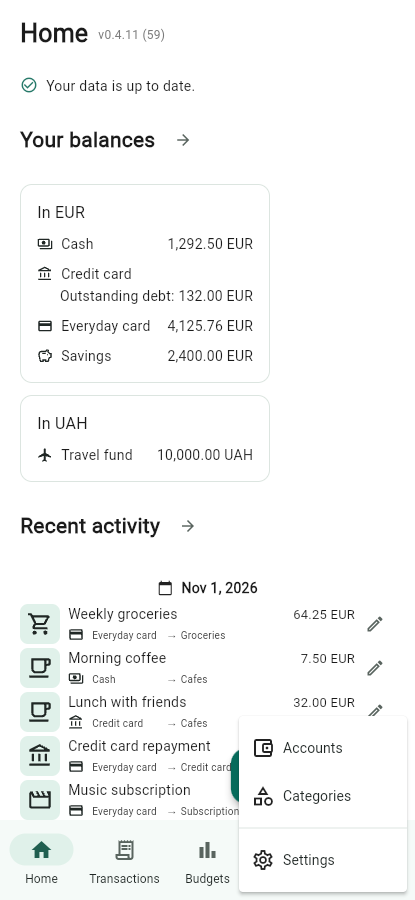
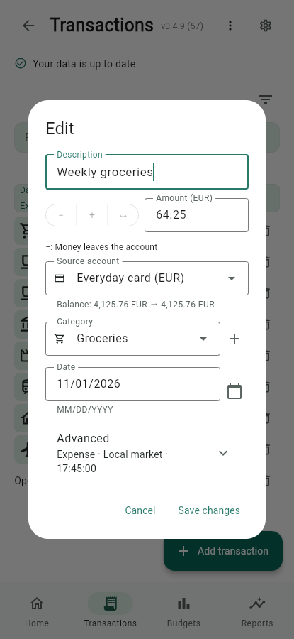
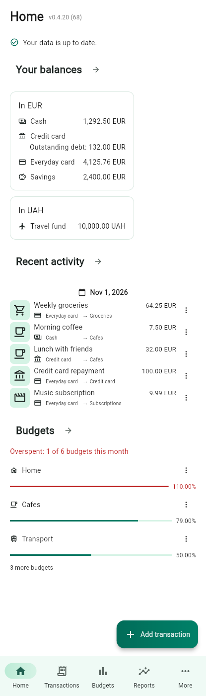
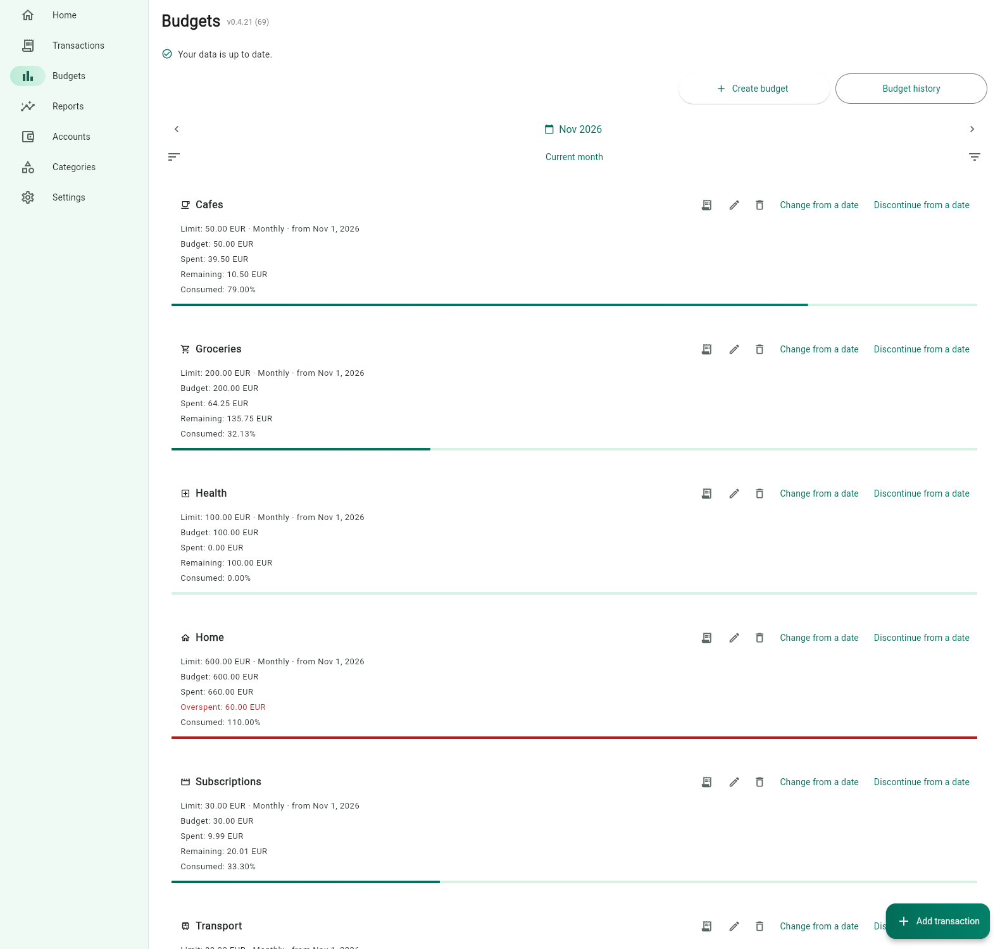
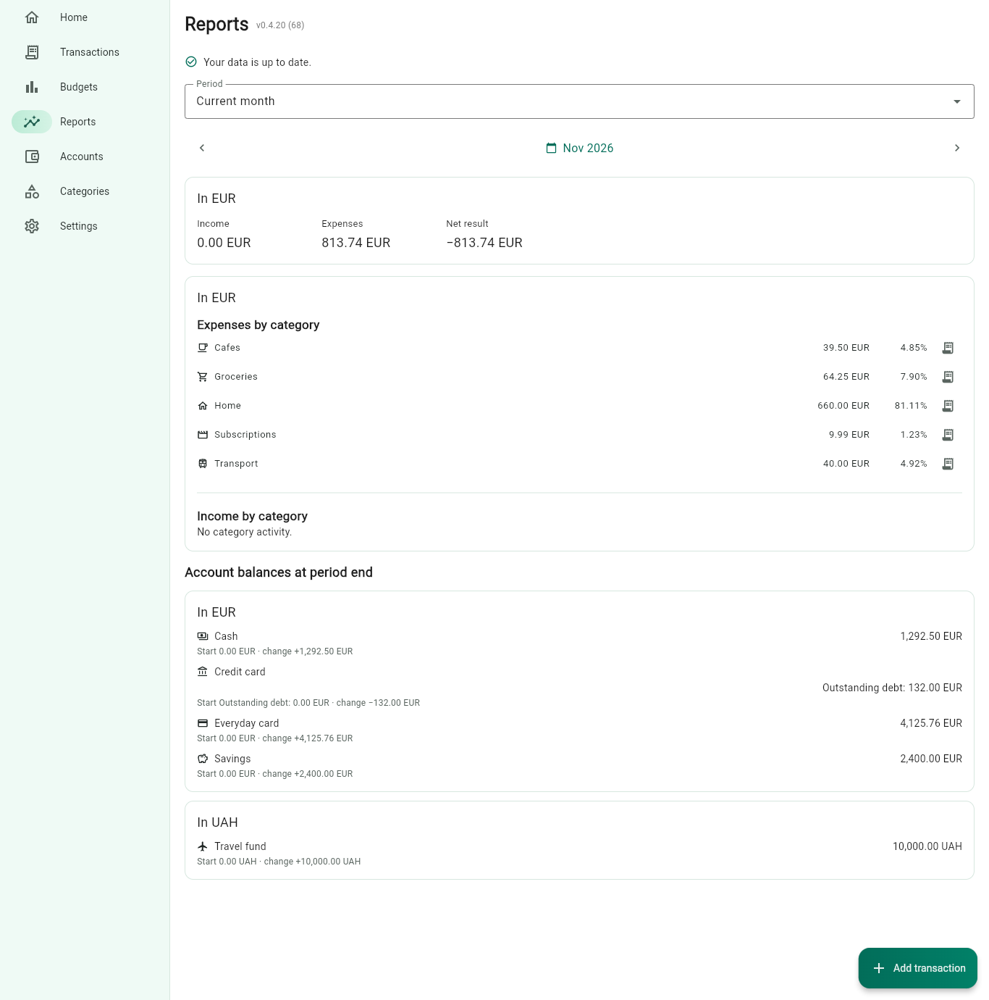

# TextMoney user guide

TextMoney records everyday finances in a single local `textmoney.beancount`
journal. Core tracking works offline, without sign-up, a backend service or
app-managed cloud storage. Icon search uses the bundled catalogue and does not
make network requests. Optional AI icon generation requires internet access
and your own provider API key. Before opening an existing Beancount book, check the
[supported journal format](journal-format.md); not every valid book is supported.

TextMoney is in beta. Keep an independent backup and follow
[sequential synchronization](synchronization.md) when using several devices.
For release-file selection and platform caveats, see
[platform requirements and troubleshooting](platform-notes.md).

## Find your way around

On desktop, the sidebar opens Home, Transactions, Budgets, Reports, Accounts,
Categories and Settings. On a phone, the bottom bar shows Home, Transactions,
Budgets, Reports and **More**. More opens Accounts, Categories and Settings,
with Settings separated from the journal-management entries. The bar remains
visible on these screens with More selected. Opening or dismissing the menu
does not change your current screen.
On the desktop app, shared **Back** and **Forward** header arrows retrace visits;
unavailable directions stay visible but disabled. Use **Alt+Left/Right** on
Windows/Linux, or **Command+[/]** on macOS. Operations visits restore their own
filters and transaction page, using current journal data rather than stale cached
transactions. Editing filters or opening a popup does not add a visit.
The mobile Back arrow returns through screens visited in this session. On Android,
system Back first dismisses the keyboard or an open menu, including a dropdown
inside a dialog. It then dismisses the active dialog before returning through
screen history; at the beginning it uses the usual platform behavior. A different
destination after going Back discards later visits. There is no mobile Forward
control. Resizing preserves the current screen and form state.

Screenshots use synthetic data from TextMoney v0.4.20 (build 68), not a personal
journal. Compact screenshots are browser-rendered mobile-layout previews, not
physical Android captures.

### Item actions

On Android, **tap an item's label or body** to open its actions menu: transactions
(including Home's recent activity), accounts, categories, budget cards/history
and report category rows. Edit/Delete and other per-item buttons are not shown
inline. Tap outside the menu or use system Back to dismiss it without changing
anything. Choose an action to open the existing editor, confirmation or scoped
transaction view. Menus open at the tap location, adjusted to fit screen edges,
and actions retain the same icons as their desktop controls.

Category expansion arrows remain separate from the tappable label. On mobile,
tap anywhere within a budget card or history item, including its figures,
progress bar and padding, for actions. Budget text remains selectable on desktop.
Tappable mobile elements show feedback within the touched element; item menus
use a bounded ripple on the original row/card. Scrolling cancels the tap without
opening a menu.
Multi-currency budget menus identify each definition by currency and effective
date. Read-only transaction previews have no mutation menu; unsupported
transactions offer details rather than editing, and deletion stays unavailable.
Accounts/categories with history still cannot be deleted; use Edit to change
their active state.

Windows/Linux retain their familiar inline action icons/buttons, including in
narrow windows. Mobile action presentation is platform-based, not width-based,
so Android keeps tap menus in landscape and on tablets. iOS selects mobile
menus and macOS desktop controls; web follows the reported operating system.
Those targets are not released or device-validated.

## Add accounts, categories and opening balances

1. Choose a dedicated local folder for your records.
2. Open **Accounts**, create an account with its currency, and optionally enter
   its opening balance and effective date. Each ordinary account has one currency.
3. Open **Categories** and add expense categories, nesting them under a parent
   if useful. Set the availability date to control when transactions can use
   the category; edit that date later in the category's **Edit** dialog. Select
   the Income category type to create income categories. On mobile, Accounts
   and Categories are under **More**.

Account/category creation offers **Choose icon** with a preview. The same picker
is available in an existing item's Edit dialog and when creating a category
inside a transaction. Canceling creation does not save the icon or lose the
unsaved transaction. The picker also offers optional AI icon generation after
[AI setup](#configure-optional-ai-features). See [icons and imports](entity-icons.md)
for validation, offline attribution and storage.

Opening balances are not current income or expenses. Their transaction rows use
**Opening balance**, including when the account has an icon. For an existing
debt, use the [debt workflow](#track-and-repay-debt) below.

## Record an expense

1. Choose **Add transaction**.
2. Enter a description in the first field, then a positive amount.
3. Select the account and expense category, or create a category beside the selector.
4. Check the date, balance preview and sign hint, then save.

The default **−** records spending; the hint explains money leaving the account.
Date stays visible. Time and optional shop/recipient are under **Advanced**.
Changing modes never changes the numeric amounts you entered.

Negative cash/bank balances, including historical overdrafts, show a warning
but do not prevent a valid save. Invalid amounts, accounts, currencies, dates
or accounting still block saving.

## Add several similar transactions

In **Add transaction**, choose an ordinary expense or income without a fee,
then select **Add multiple…**. Entered details become the first row, and its
original description also prefills each new row. Clear any drafts in other
transaction modes before switching. Set the shared account and category once;
the optional payee is under **Advanced**. Enter a date, amount and optional
description for each transaction. **Add row** carries forward the previous
date. Under **Row details**, override shared values for a particular row or
switch back to the shared value.

Review the rows and currency totals, then choose **Save N transactions**.
Each row becomes a separate transaction in Operations. Correct any errors
shown on the rows before saving; your draft remains available if a save fails.
If the save outcome is uncertain, choose **Reload and check**. Retry only when
the journal is unchanged; otherwise check Operations before starting another
batch.
Transfers, exchanges, reimbursements, adjustments and fees still use the
single-transaction form.

## Add income, a refund or an adjustment

- Switch to **+** for ordinary income. The amount stays positive and unchanged;
  the selector shows income categories.
- For a refund or partial reimbursement, use **Advanced → Money received →
  Expense reimbursement**. Choose the expense category to reduce. The money
  can arrive in a different account from the original purchase; linking that
  expense is optional.
- Choose **Balance adjustment** for receipts that should affect neither income
  nor current expenses, such as recovery of a pre-tracking purchase.

Reimbursements reduce expenses on the date received, so net expenses can be
negative for that period. A linked expense is a reference, not tracked debt:
it does not cap reimbursement amounts or update/delete linked entries for you.
Reimbursements and adjustments remain fee-free.
See [transaction semantics](journal-format.md#transactions-and-editing).

## Move money between accounts

Choose **↔** beside **− / +**. Transfer mode requires a **source** and
**destination** account, rather than the single account used for expenses and
income. Check the direction preview and enter the amount.

For same-currency transfers, enable an optional fee under **Advanced** and
choose whether it is added on top or deducted from the entered amount.
Choose its category for that transfer, or configure a shared default in Settings.
The initial bank-fee category is created automatically on its first nonzero use.
Only fees are expenses; moving your own money does not count as income or spending.

To reverse a transfer, explicitly swap its source/destination and amounts.
Switching the selected mode does not reverse it or recalculate entered amounts.

## Exchange currencies

For accounts in different currencies, enter **Total debited** and
**Actually credited**. Neither actual amount is calculated or replaced.

If there is a fee, select its currency under **Advanced**:

- A source-currency fee is included in the debited total.
- A destination-currency fee has already been withheld from the credited amount.

The preview derives the exchanged principal and rate excluding fees. For
example, 105 USD debited including a 5 USD fee and 4200 UAH credited means
100 USD exchanged at 42 UAH/USD. Fees cannot use a third currency.
Transaction rows show the received amount above the smaller, minus-prefixed
debited amount at the same right edge; on narrow screens the debit stays beside
the account labels rather than dropping to a third line.
See [exchange representation and precision](journal-format.md#transfers-and-exchange-precision).

## Track and repay debt

1. Choose **Loan / credit** when creating a credit-card, loan or personal-debt
   account. Enter any existing debt as a positive opening amount owed, with its
   opening date; that opening debt is not an expense.
2. Record credit-funded purchases and manually charged interest as ordinary
   categorized expenses using that account.
3. Repay it with a transfer from a cash/bank account, not another expense.
   Only an optional repayment fee affects spending or budgets.

Negative native `Liabilities:` balances appear as positive **Outstanding debt**.
Zero is zero debt; an overpayment appears as **Credit balance**. Home, Accounts,
balance hints and Reports use these labels, while journal/per-currency totals
retain signed Beancount values. See [liability examples](journal-format.md#liability-accounts).

## Add fees and choose defaults

Ordinary expenses and income support an optional fixed-amount commission under
**Advanced**, added on top or deducted from the entered amount. The preview shows
the purchase/gross income and actual debit/net credit. The fee uses the selected
account's currency; percentage fees are not supported.

Any active expense category can be a fee category; `Expenses:Bank-Fees` is only
the initial default. Select commission branches (including descendants) and a
separate default in Settings. Fee selectors show hierarchy, with all expense
categories available until the list is narrowed.

**Save** publishes commission branches/default together for the selected journal,
independently of the default transaction account. New forms use shared defaults;
existing drafts and saved transactions retain their choices. To disable account
preselection, choose **No default account** and Save.
See [shared-settings publication and conflicts](shared-settings.md) for the primary
instructions. Purchases and fees stay in one transaction, identified by posting
order rather than fee-mode metadata; see [accounting examples](journal-format.md#purchase-and-income-commissions).

## Edit or remove records

Use the pencil or trash icon on a transaction. Deletion requires confirmation.
The same form opens for editing, with its operation type fixed to preserve the
accounting treatment; transfer direction can still be reversed. Advanced starts
collapsed with a summary of saved fees, payee and time. Opening balances can be
edited from the account or its opening transaction. Some readable, externally
authored or split transactions have no editor/deleter; see [format limits](journal-format.md).

Accounts/categories with history can be deactivated and reactivated without
losing records. Deleting one with history, or a category with children, opens an
explanation instead of its editor: choose **Edit** to change its Active checkbox.
Cancel or Escape leaves it unchanged. Unused items have a permanent-deletion
confirmation. A display-name edit does not rename posting codes; guarded desktop
[category migration](journal-format.md#moving-and-renaming-an-existing-category)
is a separate operation.

On wider layouts, a subtle row-wide hover highlight connects actions to the
account, category, transaction or budget. **Escape** cancels the active desktop
popup; **Enter** submits through its normal checks, except in the AI icon prompt,
where it starts generation rather than saving the picker. **Shift+Enter** adds a line
in multiline descriptions. Focused buttons/dropdowns keep their normal keyboard
actions and disabled actions cannot be submitted. Validation errors in account,
category and transaction edit dialogs appear in an error popup; dismiss it to
correct the retained draft. They do not replace persistent journal or storage
status on other screens.
If an external change makes an edit stale, follow [review steps](synchronization.md#reviewing-external-changes)
rather than resubmitting the old form.

## Review balances, budgets and spending

Home groups balances by currency and recent transactions by date.
Assigned category icons lead expense, income and reimbursement rows; transfers
use the destination-account icon and opening balances the opened-account icon.
These leading icons are not repeated beside their movement label.

Home also previews the current month's budgets below balances in the wide left
column, or after recent activity in a single column. The heading arrows open
the full screens. See [Home budget preview](budgets.md#home-budget-preview) for
ranking, row limits, currencies, empty states and the Settings toggle.

Use **Budgets** to create and review limits, browse months, filter categories or
overspending, drill into transactions and open **Budget history**. Dated changes
preserve earlier limits, and **Budget order** arranges categories across months.
See [budgeting](budgets.md) and [shared budget ordering](shared-settings.md#budget-ordering)
for detailed behavior.

Use **Reports** for income, net expenses and net result over the current/previous
month, year to date or a custom range, plus category and account breakdowns.
Reimbursements reduce expenses on their recorded dates; fees remain expenses.
Transfer/loan principal and balance adjustments are excluded. Different currencies
are always separate; reports do not infer exchange rates.
Transactions also has clickable per-day summaries.
It shows up to 50 operations at a time. Use the quiet **Older** and **Newer**
links above or below the list to browse history; **Latest** returns to recent
operations. Changing pages scrolls to the top of the screen. Account/category,
date range, currency and payee/description filters search the entire history,
not just the current page. Applied filters have removable chips.
**Clear all filters**, beside the filter toggle, clears all restrictions and
date-entry errors and returns to the latest page. It stays visible with the
filter panel collapsed, and is disabled when there is nothing to clear.
Report category buttons open this full browser with the report scope selected.
Budget transaction buttons retain a read-only preview (up to 50 matches), with
**Open in Operations** for the complete matching list and editing. The handoff
preserves the preview's month, category, currency and search. Shared Back
navigation preserves the originating Budgets or Reports view.
A date's summary
includes all matching operations on that day, even when they span several pages.
It summarizes whole transactions, not only the selected category/currency postings.
See [reporting](reporting.md) for calculations and report scope.

## Adjust appearance and display settings

Settings offers system/light/dark appearance and system or explicit timezones.
Translations are English, Ukrainian and Russian. Language, theme, clock timezone,
backup cleanup and the Home-budget toggle remain device-local.
The Settings page labels device settings separately from journal-shared defaults;
AI and Advanced settings are expandable sections.
Timezone selection affects the default clock and current report/budget periods,
not saved transaction dates or times.

**Settings → Advanced → Journal display currencies** controls Home balance
section order and how compatible apps organize amounts. Account currencies not
listed appear afterward alphabetically; currencies without accounts do not add
empty sections. Save to apply it. This does not exchange currencies or combine
balances. See [journal display settings](journal-format.md#journal-display-settings-and-preserved-directives).
The app version/build appear in screen headers and Settings.
Translation maintenance is documented in [localization](localization.md).

## Configure optional AI features

Open **Settings → AI**. Choose a provider, enter and save its API key, then
choose an image-generation model from that provider. Open an account or category's
**Choose icon** picker and expand **Generate with AI**. Describe the icon and
choose **Generate**; review the result and choose **Save changes** to apply it.
The **Reference icon (optional)** selector defaults to **No reference**. Choose
the icon present when this dialog opened, or an icon from another category/account
in the same journal, to request a modification based on it. Choices show an icon,
name and code; choosing a reference does not change the icon selected for saving.
Choose No reference again to disable it. You can also use the offline catalogue
without configuring AI.

**Adapt generated icons to the theme** is on by default in Settings → AI.
Neutral parts follow the theme while colored accents keep their colors.
Adaptation is heuristic; turn it off to preserve the generated image's original
colors. This setting affects future generations, not existing icons or imports.

Generation sends your description and the app's hidden instructions to the
selected provider; it sends a reference image too only when one is selected.
Reference category/account names and codes are not sent, and the journal is not
uploaded. Provider terms and charges apply. Generated-image rights are not
verified; check your rights, including those concerning any reference icon, before use. OpenAI,
Google Gemini and xAI image-generation models are available. The separate
image-understanding model setting does not currently provide receipt parsing.

API keys and model choices stay on the device, not in the journal or shared
settings. Key management requires the platform's secure storage; on Linux this
means a working Secret Service. Browser previews cannot manage keys. Saving a
key does not verify it with the provider. See [icons and AI](entity-icons.md)
for details.

## Backups and next steps

Follow [sync between devices](synchronization.md) and
[backups and interrupted-save recovery](data-safety.md) before relying on
multi-device editing. Backups are not automatic undo or a substitute for an
independent copy.
Published version history is in [GitHub Releases](https://github.com/pioneer/textmoney/releases).

Split-expense editing remains a planned area, not a supported editing workflow.
Priorities and scope may change during beta, with no release dates promised.
