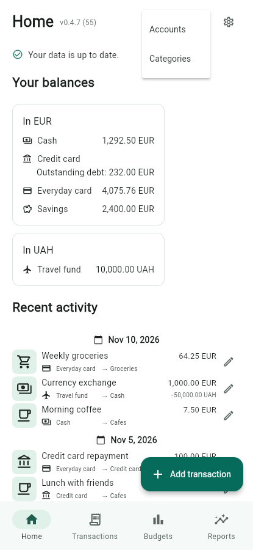
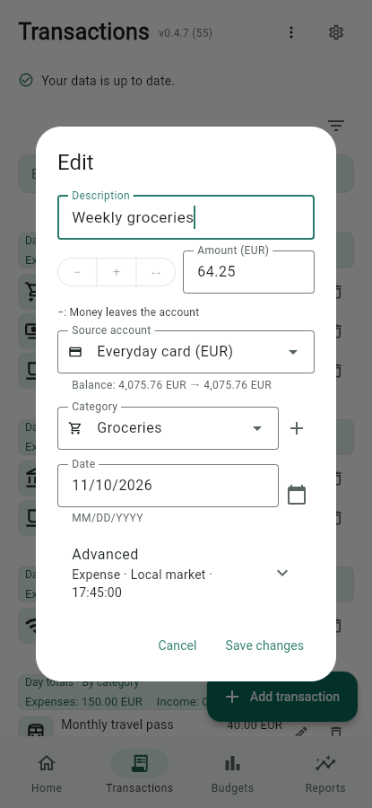
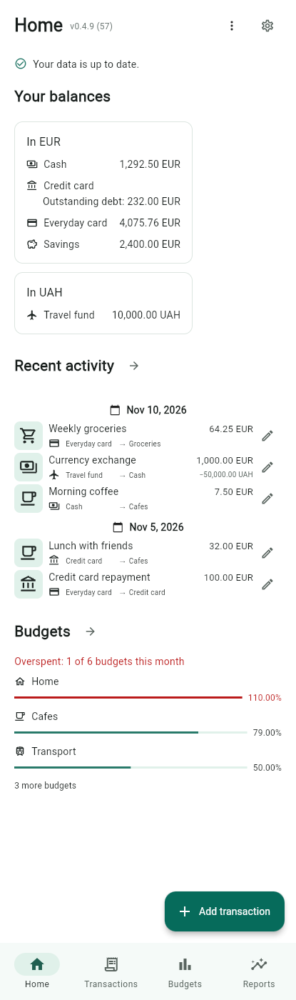
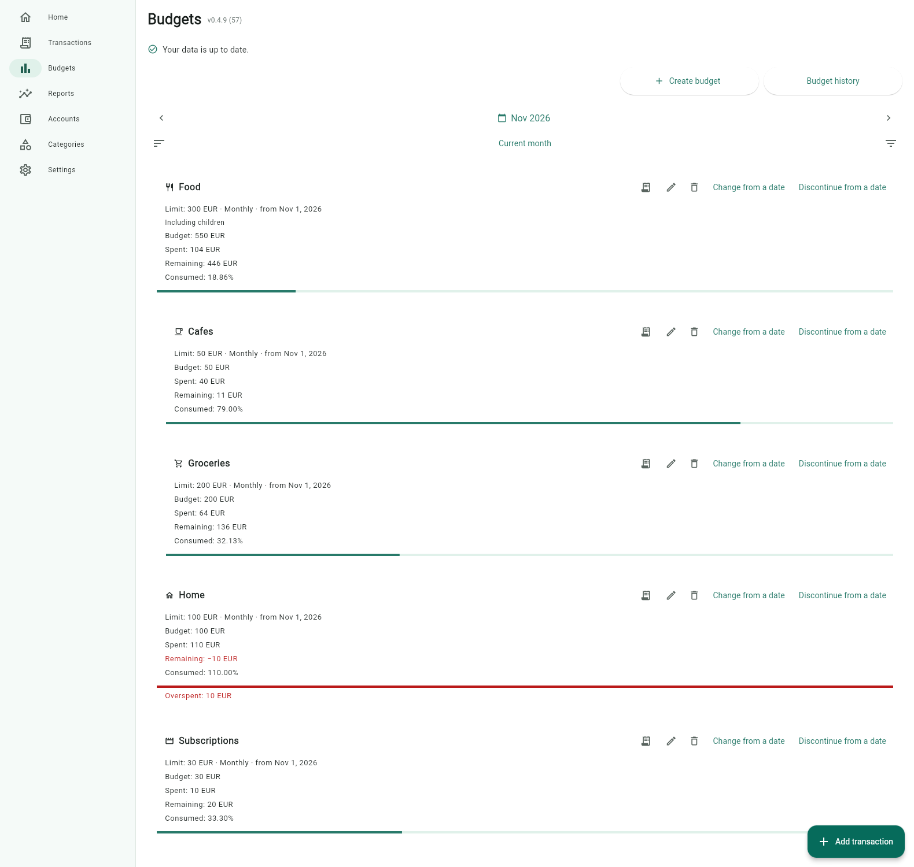
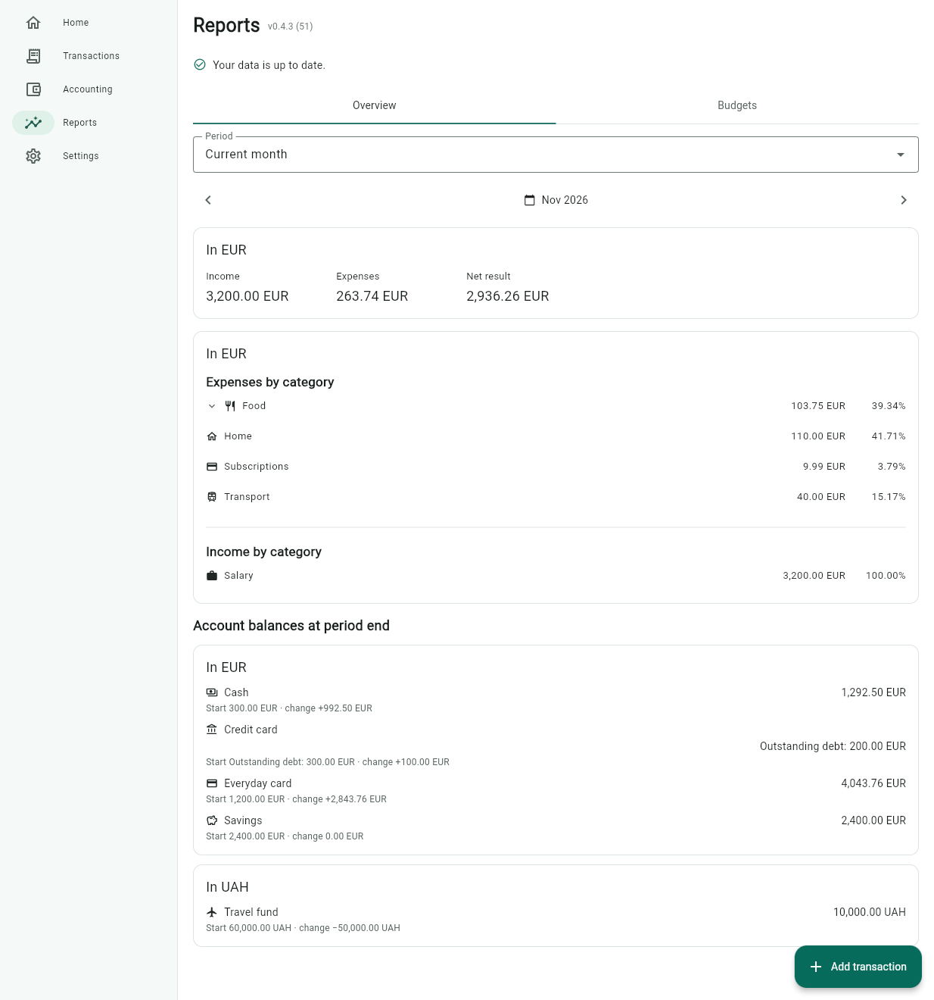

# TextMoney user guide

TextMoney records everyday finances in a single local `textmoney.beancount`
journal. Core tracking works offline, without sign-up, a backend service or
app-managed cloud storage. Optional online icon search contacts Iconify only
when requested. Before opening an existing Beancount book, check the
[supported journal format](journal-format.md); not every valid book is supported.

TextMoney is in beta. Keep an independent backup and follow
[sequential synchronization](synchronization.md) when using several devices.
For release-file selection and platform caveats, see
[platform requirements and troubleshooting](platform-notes.md).

## Find your way around

On desktop, the sidebar opens Home, Transactions, Budgets, Reports, Accounts,
Categories and Settings. On a phone, the bottom bar opens the first four;
**More** beside the separate Settings gear opens Accounts and Categories.
Secondary screens have a Back action. Resizing preserves the current screen
and form state.

Screenshots use synthetic data from TextMoney v0.4.9 (build 57), not a personal
journal. Compact screenshots are browser-rendered mobile-layout previews, not
physical Android captures.

## Add accounts, categories and opening balances

1. Choose a dedicated local folder for your records.
2. Open **Accounts**, create an account with its currency, and optionally enter
   its opening balance and effective date. Each ordinary account has one currency.
3. Open **Categories** and add expense categories, nesting them under a parent
   if useful. Select the Income category type to create income categories.
   On mobile, Accounts and Categories are under **More**.

Account/category creation offers **Choose icon** with a preview. The same picker
is available in an existing item's Edit dialog and when creating a category
inside a transaction. Canceling creation does not save the icon or lose the
unsaved transaction. See [icons, imports and online search](entity-icons.md)
for validation, offline attribution and storage.

Opening balances are not current income or expenses. Their transaction rows use
**Opening balance**, including when the account has an icon. For an existing
debt, use the [debt workflow](#track-and-repay-debt) below.

## Record an expense

1. Choose **Add transaction**.
2. Enter a description in the first field, then a positive amount.
3. Select the account and expense category, or create a category beside the selector.
4. Check the date, balance preview and sign hint, then save.

The default **−** records spending; the hint explains money leaving the account.
Date stays visible. Time and optional shop/recipient are under **Advanced**.
Changing modes never changes the numeric amounts you entered.

Negative cash/bank balances, including historical overdrafts, show a warning
but do not prevent a valid save. Invalid amounts, accounts, currencies, dates
or accounting still block saving.

## Add income, a refund or an adjustment

- Switch to **+** for ordinary income. The amount stays positive and unchanged;
  the selector shows income categories.
- For a refund or partial reimbursement, use **Advanced → Money received →
  Expense reimbursement**. Choose the expense category to reduce. The money
  can arrive in a different account from the original purchase; linking that
  expense is optional.
- Choose **Balance adjustment** for receipts that should affect neither income
  nor current expenses, such as recovery of a pre-tracking purchase.

Reimbursements reduce expenses on the date received, so net expenses can be
negative for that period. A linked expense is a reference, not tracked debt:
it does not cap reimbursement amounts or update/delete linked entries for you.
Reimbursements and adjustments remain fee-free.
See [transaction semantics](journal-format.md#transactions-and-editing).

## Move money between accounts

Choose **↔** beside **− / +**. Transfer mode requires a **source** and
**destination** account, rather than the single account used for expenses and
income. Check the direction preview and enter the amount.

For same-currency transfers, enable an optional fee under **Advanced** and
choose whether it is added on top or deducted from the entered amount.
Choose its category for that transfer, or configure a shared default in Settings.
The initial bank-fee category is created automatically on its first nonzero use.
Only fees are expenses; moving your own money does not count as income or spending.

To reverse a transfer, explicitly swap its source/destination and amounts.
Switching the selected mode does not reverse it or recalculate entered amounts.

## Exchange currencies

For accounts in different currencies, enter **Total debited** and
**Actually credited**. Neither actual amount is calculated or replaced.

If there is a fee, select its currency under **Advanced**:

- A source-currency fee is included in the debited total.
- A destination-currency fee has already been withheld from the credited amount.

The preview derives the exchanged principal and rate excluding fees. For
example, 105 USD debited including a 5 USD fee and 4200 UAH credited means
100 USD exchanged at 42 UAH/USD. Fees cannot use a third currency.
Transaction rows show the received amount above the smaller, minus-prefixed
debited amount at the same right edge; on narrow screens the debit stays beside
the account labels rather than dropping to a third line.
See [exchange representation and precision](journal-format.md#transfers-and-exchange-precision).

## Track and repay debt

1. Choose **Loan / credit** when creating a credit-card, loan or personal-debt
   account. Enter any existing debt as a positive opening amount owed, with its
   opening date; that opening debt is not an expense.
2. Record credit-funded purchases and manually charged interest as ordinary
   categorized expenses using that account.
3. Repay it with a transfer from a cash/bank account, not another expense.
   Only an optional repayment fee affects spending or budgets.

Negative native `Liabilities:` balances appear as positive **Outstanding debt**.
Zero is zero debt; an overpayment appears as **Credit balance**. Home, Accounts,
balance hints and Reports use these labels, while journal/per-currency totals
retain signed Beancount values. See [liability examples](journal-format.md#liability-accounts).

## Add fees and choose defaults

Ordinary expenses and income support an optional fixed-amount commission under
**Advanced**, added on top or deducted from the entered amount. The preview shows
the purchase/gross income and actual debit/net credit. The fee uses the selected
account's currency; percentage fees are not supported.

Any active expense category can be a fee category; `Expenses:Bank-Fees` is only
the initial default. Select commission branches (including descendants) and a
separate default in Settings. Fee selectors show hierarchy, with all expense
categories available until the list is narrowed.

**Save** publishes commission branches/default together for the selected journal,
independently of the default transaction account. New forms use shared defaults;
existing drafts and saved transactions retain their choices. To disable account
preselection, choose **No default account** and Save.
See [shared-settings publication and conflicts](shared-settings.md) for the primary
instructions. Purchases and fees stay in one transaction, identified by posting
order rather than fee-mode metadata; see [accounting examples](journal-format.md#purchase-and-income-commissions).

## Edit or remove records

Use the pencil or trash icon on a transaction. Deletion requires confirmation.
The same form opens for editing, with its operation type fixed to preserve the
accounting treatment; transfer direction can still be reversed. Advanced starts
collapsed with a summary of saved fees, payee and time. Opening balances can be
edited from the account or its opening transaction. Some readable, externally
authored or split transactions have no editor/deleter; see [format limits](journal-format.md).

Accounts/categories with history can be deactivated and reactivated without
losing records. Deleting one with history, or a category with children, opens an
explanation instead of its editor: choose **Edit** to change its Active checkbox.
Cancel or Escape leaves it unchanged. Unused items have a permanent-deletion
confirmation. A display-name edit does not rename posting codes; guarded desktop
[category migration](journal-format.md#moving-and-renaming-an-existing-category)
is a separate operation.

On wider layouts, a subtle row-wide hover highlight connects actions to the
account, category, transaction or budget. **Escape** cancels the active desktop
popup; **Enter** submits through its normal checks. **Shift+Enter** adds a line
in multiline descriptions. Focused buttons/dropdowns keep their normal keyboard
actions and disabled actions cannot be submitted.
If an external change makes an edit stale, follow [review steps](synchronization.md#reviewing-external-changes)
rather than resubmitting the old form.

## Review balances, budgets and spending

Home groups balances by currency and recent transactions by date.
Assigned category icons lead expense, income and reimbursement rows; transfers
use the destination-account icon and opening balances the opened-account icon.
These leading icons are not repeated beside their movement label.

Home also previews the current month's budgets below balances in the wide left
column, or after recent activity in a single column. The heading arrows open
the full screens. See [Home budget preview](budgets.md#home-budget-preview) for
ranking, row limits, currencies, empty states and the Settings toggle.

Use **Budgets** to create and review limits, browse months, filter categories or
overspending, drill into transactions and open **Budget history**. Dated changes
preserve earlier limits, and **Budget order** arranges categories across months.
See [budgeting](budgets.md) and [shared budget ordering](shared-settings.md#budget-ordering)
for detailed behavior.

Use **Reports** for income, net expenses and net result over the current/previous
month, year to date or a custom range, plus category and account breakdowns.
Reimbursements reduce expenses on their recorded dates; fees remain expenses.
Transfer/loan principal and balance adjustments are excluded. Different currencies
are always separate; reports do not infer exchange rates.
Transactions also has clickable per-day summaries.
It shows up to 50 operations at a time. Use the quiet **Older** and **Newer**
links above or below the list to browse history; **Latest** returns to recent
operations. Changing pages scrolls to the top of the screen. Account/category
filters search the entire history, not just the current page. A date's summary
includes all matching operations on that day, even when they span several pages.
See [reporting](reporting.md) for calculations and report scope.

## Adjust appearance and display settings

Settings offers system/light/dark appearance and system or explicit timezones.
Translations are English, Ukrainian and Russian. Language, theme, clock timezone,
backup cleanup and the Home-budget toggle remain device-local.
Timezone selection affects the default clock and current report/budget periods,
not saved transaction dates or times.

**Settings → Advanced → Journal display currencies** controls Home balance
section order and how compatible apps organize amounts. Account currencies not
listed appear afterward alphabetically; currencies without accounts do not add
empty sections. Save to apply it. This does not exchange currencies or combine
balances. See [journal display settings](journal-format.md#journal-display-settings-and-preserved-directives).
The app version/build appear in screen headers and Settings.
Translation maintenance is documented in [localization](localization.md).

## Backups and next steps

Follow [sync between devices](synchronization.md) and
[backups and interrupted-save recovery](data-safety.md) before relying on
multi-device editing. Backups are not automatic undo or a substitute for an
independent copy.
Published version history is in [GitHub Releases](https://github.com/pioneer/textmoney/releases).

Split-expense editing remains a planned area, not a supported editing workflow.
Priorities and scope may change during beta, with no release dates promised.
